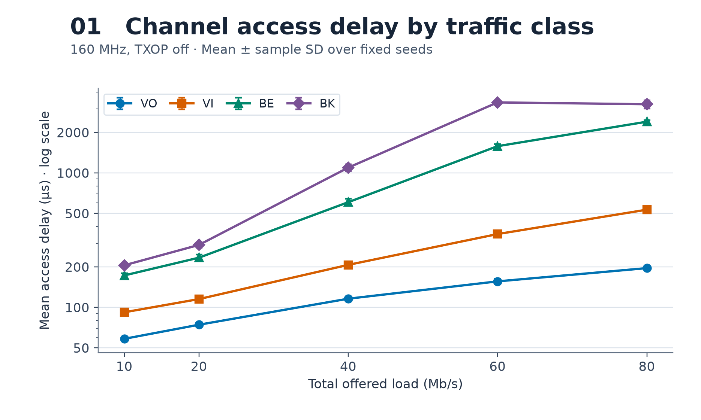
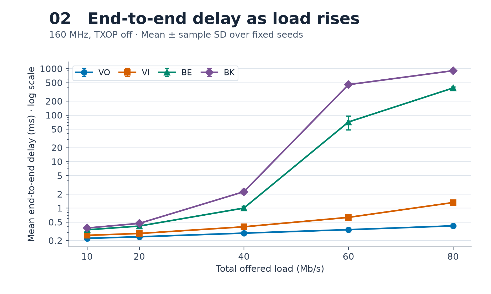
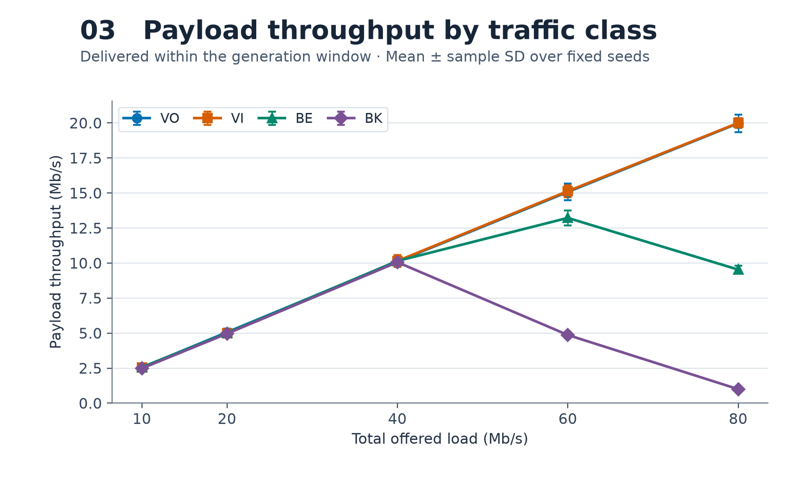
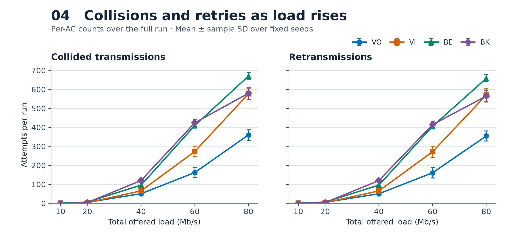
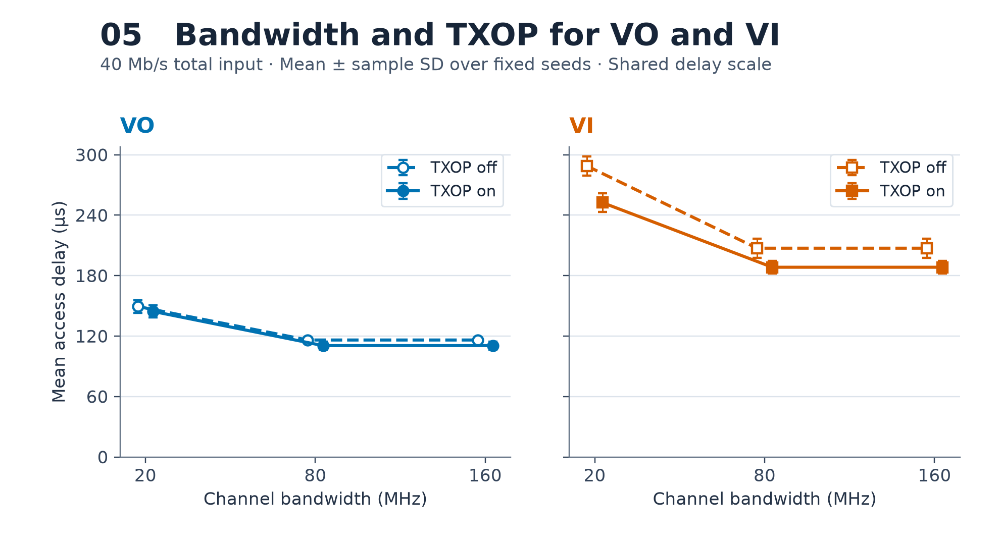

# EDCA 专项测试报告

五档负载、五个种子的平均接入时延和平均端到端时延均满足 **VO < VI < BE < BK**。40 Mb/s 时 BE、BK 的时延已开始明显拉大，60 Mb/s 时出现大量积压。40 Mb/s 下，20 MHz 扩至 80 MHz 能明显降低时延，80 与 160 MHz 的结果完全一致。开启 VO、VI 的 TXOP 后，两类业务的时延均下降，其中 VI 的改善更大。

## 实验设置

1 个 SFU 和 4 个固定关联的 STA 共用无线信道。总输入一半为 MFU 下行，一半为四个 STA 平分的上行。各发送源按 AC 独立生成泊松流，VO、VI、BE、BK 各占四分之一的期望输入，载荷统一为 1200 B。每次从空队列开始，生成业务 1 s 后继续运行至队列排空。种子固定为 11、29、47、71、101。所有均值和样本标准差都以单次运行的指标为样本。

两组实验均使用完整的现有 EDCA 接入流程、MCS 11、2 NSS 和 0.8 μs GI。沿用默认 ACK 模型（24 Mb/s，28 μs）与 SIFS（16 μs），光侧固定时延为 100 μs，最大重传 3 次。负载实验固定 160 MHz、各 AC 的 TXOP Limit 为 0。带宽实验固定总输入 40 Mb/s，对照全部为 0 与 VO 为 1504 μs、VI 为 3008 μs、BE/BK 为 0 两种配置。同负载、同种子的报文生成序列逐项核对一致。

- **接入时延**从报文成为本设备、本 AC 的队首算到最终成功的 DATA 开始，含 AIFS、退避、冻结和失败尝试的等待。**端到端时延**从生成算到最终目的节点收到 DATA。两项均统计全程成功交付的报文，包含排空阶段。
- **吞吐量**按生成窗口内成功交付的有效载荷计算，分母固定为 1 s。横轴为泊松流的期望输入速率，实际生成量随种子波动。例如 40 Mb/s 点的实测平均输入为 40.52 Mb/s。
- **碰撞次数**按各 AC 参与跨设备碰撞的 DATA 尝试计数。一次双设备碰撞计入两次尝试。**重传次数**按实际再次开始的 DATA 尝试计数。两者都覆盖排空阶段。**丢包率**为排空后最终重试超限数除以生成数。**信道占用率**为占用区间的并集除以完整仿真时长。

## 实验 1　负载影响

接入时延的四类排序在 25 次运行中全部成立。20→40 Mb/s 时，BE 和 BK 的平均接入时延分别由 234、292 μs 增至 606、1095 μs，跨设备碰撞尝试由平均 20 次增至 333 次。**40→60 Mb/s 区间出现明显吞吐量受限和积压**。60 Mb/s 时，BK 平均端到端时延达到 455 ms，且生成窗口结束后平均还需约 320 ms 才能排空。80 Mb/s 时，VO、VI 在输入窗口内仍各交付约 20 Mb/s，BE 降至 9.53 Mb/s，BK 降至 1.00 Mb/s。观察到的排序反映分业务均值，单次争用的结果由到达时机及退避决定。

| 总输入（Mb/s） | BE 端到端（ms） | BK 端到端（ms） | 总吞吐量（Mb/s） | 总丢包率 | 全程信道占用率 |
| ---: | ---: | ---: | ---: | ---: | ---: |
| 10 | 0.341 ± 0.007 | 0.374 ± 0.007 | 10.15 | 0.000% | 11.43% |
| 20 | 0.411 ± 0.016 | 0.470 ± 0.017 | 20.03 | 0.000% | 22.61% |
| 40 | 1.004 ± 0.090 | 2.258 ± 0.293 | 40.48 | 0.023% | 46.58% |
| 60 | 71.463 ± 23.643 | 454.869 ± 13.578 | 48.31 | 0.261% | 54.20% |
| 80 | 385.080 ± 21.587 | 907.487 ± 24.086 | 50.52 | 0.460% | 54.58% |

图 1、2 使用对数纵轴。误差棒为五个种子的样本标准差。计数图的误差棒下限最低显示到零。









## 实验 2　带宽与 TXOP

TXOP 关闭时，带宽由 20 增至 80 MHz，四类业务平均接入时延均下降。BK 的平均端到端时延由 28.58 降至 2.26 ms，总吞吐量由 39.90 升至 40.48 Mb/s。1200 B 报文在 20、80、160 MHz 下的 DATA 时长分别为 91.2、64.0、64.0 μs。80 和 160 MHz 都只需要一个数据符号，完整 DATA–SIFS–ACK 均为 108 μs，两档带宽在每个配对种子下的全部输出指标一致。

| 带宽（MHz） | VO 接入时延（μs，关 → 开） | VI 接入时延（μs，关 → 开） | VO / VI 降幅 |
| ---: | ---: | ---: | ---: |
| 20 | 149.4 ± 6.2 → 144.5 ± 6.2 | 288.8 ± 9.5 → 252.5 ± 9.3 | 3.3% / 12.6% |
| 80 | 116.1 ± 1.6 → 110.5 ± 3.8 | 207.3 ± 9.5 → 188.3 ± 6.4 | 4.8% / 9.1% |
| 160 | 116.1 ± 1.6 → 110.5 ± 3.8 | 207.3 ± 9.5 → 188.3 ± 6.4 | 4.8% / 9.1% |

三个带宽下的五个配对种子中，开启 TXOP 后 VO、VI 的平均接入和端到端时延均降低。改善在直接启用 TXOP 的两类中以 **VI** 最明显，其平均端到端时延降幅为 6.1%–9.1%，VO 为 1.9%–2.1%。BK 在 20 MHz 下也观察到间接改善，平均端到端时延由 28.58 降至 17.80 ms。以上对比针对 40 Mb/s 及本次 TXOP 配置。



## 验收与复现

Maven 原有 130 项测试全部通过。两组共运行 50 个不同的配置与种子组合，共生成 215,559 个报文，其中成功交付 215,242 个，重试超限丢弃 317 个。逐事件核对了报文守恒、唯一交付、DATA 与 ACK 时序、占用区间、CW 更新及重传与丢包计数。40 Mb/s、160 MHz、TXOP 关闭、种子 11 的复跑得到相同的完整事件轨迹哈希。当前 EDCA 可以作为 **Main 的无线 MAC 仿真基线**，适用于现有静态 PHY、理想同信道和固定关联的实验范围。[已有综合验收及模型边界](05-edca-acceptance.md)

在仓库根目录运行以下命令。仿真脚本使用 Python 标准库，本报告图表使用 Matplotlib 3.11.2。两组共用的 40 Mb/s、160 MHz、TXOP 关闭点只运行一遍。

```powershell
mvn -o clean package
python -B tools/run_edca_focus.py
python -m pip install matplotlib
python -B tools/plot_edca_focus.py
```

每个 AC 的完整均值和标准差见[汇总数据](../results/edca-focus/aggregate.csv)，可结合[逐种子数据](../results/edca-focus/runs.csv)、[总丢包与占用数据](../results/edca-focus/totals.csv)及[运行核验记录](../results/edca-focus/verification.json)复核。
