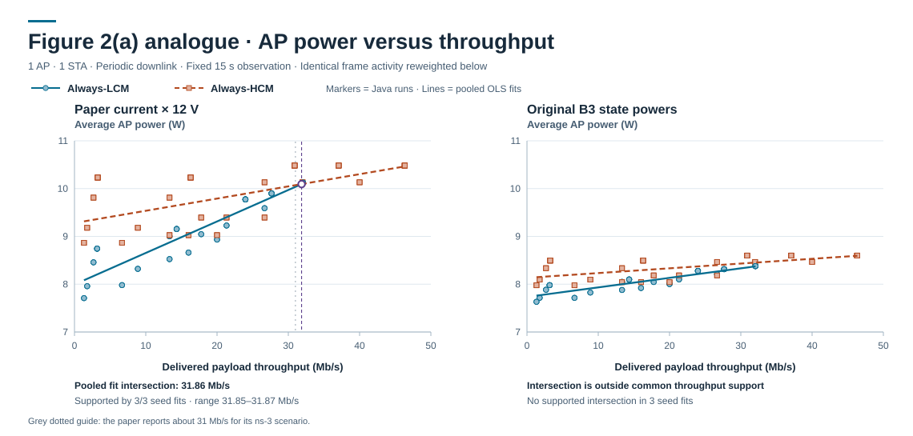
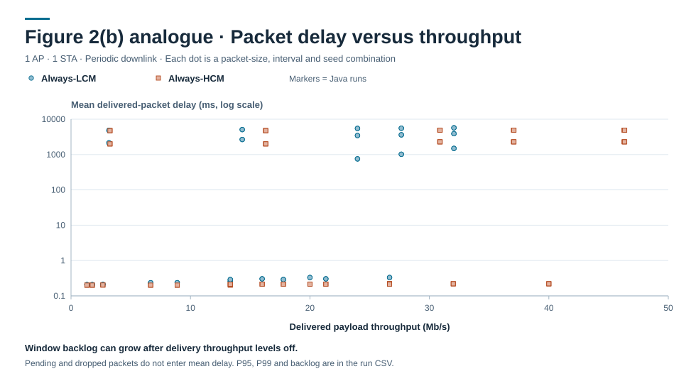

# B5 补充实验　复现 Figure 2 的静态模式功率交叉

使用论文电流重算原 B5 后，下行平均功率在 **25–30 Mb/s** 和 **35–40 Mb/s** 两次换号，横轴为相同输入负载。独立的 15 s 单 AP／单 STA 周期下行实验以成功吞吐量为横轴，论文功率下的全样本线性拟合交于 **31.86 Mb/s**，三个种子的拟合值为 **31.85–31.87 Mb/s**。筛除明显积压的样本会改变拟合结果。在同一批独立实验上使用 B3 功率时，全样本拟合交点超出两档共同测得的吞吐范围。

## 正式论文与功率参数

对照 Sánchez-Vital 等人发表于 *IEEE Wireless Communications* 32(6)、157–164 页的正式版本。第 IV 节 Figure 2 采用 ns-3 的单 AP、单 STA 下行，持续 15 s，使用 IEEE 802.11ac、MCS 7、Short GI、16 dBm。不同散点对应不同包长和发送间隔组合，文中给出的范围分别为 100–1500 B 和 90–600 μs。图 2(a) 以应用层吞吐量为横轴，对两档分别作线性回归，文中报告交叉约 31 Mb/s。图 2(b) 展示逐包时延分布，论文第 IV 节未提供分组或分位数的计算方法。[正式发表 PDF，§IV、Figure 2，第 161 页](https://upcommons.upc.edu/server/api/core/bitstreams/ed00c19a-d7e7-404b-8b75-b586d828c6c5/content) · [IEEE DOI](https://doi.org/10.1109/MCOM.004.2400486)

| 模式 | 状态 | 论文电流（A） | 论文 12 V 换算（W） | B3 研究初值（W） |
|---|---|---:|---:|---:|
| LCM 20 MHz／1 SS | IDLE | 0.58 | 6.96 | 7.38 |
| LCM | TX | 1.08 | 12.96 | 9.20 |
| LCM | RX | 0.66 | 7.92 | 8.20 |
| HCM 80 MHz／2 SS | IDLE | 0.66 | 7.92 | 7.62 |
| HCM | TX | 1.25 | 15.00 | 10.50 |
| HCM | RX | 1.00 | 12.00 | 8.70 |

论文说明电流取自其参考文献 [13] 的真实设备测量。这里以 `P = 12 V × I` 换算为等效 AP 设备功率，复用 Java 窗内 IDLE、TX、RX 纳秒时长。每状态能耗为 `P(W) × T(ns) ÷ 1000` μJ，平均功率为总能耗除以观察时间。两组功率并列积分，静态模式全程处于三种活动状态之一。16 dBm 是论文设定的射频发射功率，与表中设备耗电功率的量纲和用途不同。[功率参数 CSV](../../results/b5-paper-replication/paper-vs-b3-power-parameters.csv)

## 第一步　原 B5 活动数据重算

从原 B5 的 234 次 Java 运行读取已结算的纳秒时长，仅替换积分系数。逐行核对原有 B3 能耗及固定窗口，并保留原始成功比特数、队列积压和输入配对。下表为三个种子的下行均值，差值定义为 HCM − LCM。

| 相同输入负载（Mb/s） | LCM／HCM 成功吞吐量（Mb/s） | B3 平均功率差（W） | 论文功率重算差（W） |
|---:|---:|---:|---:|
| 25 | 23.904／23.947 | +0.06506 | +0.07363 |
| 30 | 28.672／28.725 | +0.03016 | −0.10322 |
| 35 | 31.392／33.419 | +0.06245 | −0.06734 |
| 40 | 32.491／38.197 | +0.15160 | +0.14603 |

两个换号区间均得到三个种子支持。按论文功率重算，UL 与双向仍未出现换号。B3 原始功率在三个方向都未见固定窗口交叉。下行 30 Mb/s 时，LCM／HCM 的 TX 时间分别占窗口约 49.48%／23.22%，为 HCM 补偿较高空闲功率提供了空间。到了 40 Mb/s，LCM／HCM 平均积压为约 184／5 包，两档实际交付量拉开。该反向换号对应相同输入和窗口，不能直接解释为同一成功吞吐量处的交叉。[重算逐次 CSV](../../results/b5-paper-replication/b5-paper-power-reweight.csv) · [负载差值](../../results/b5-paper-replication/b5-reweight-power-deltas.csv) · [各种子换号区间](../../results/b5-paper-replication/b5-reweight-crossings.csv)

## 第二步　独立论文对齐实验

| 项目 | 本次运行 | 与论文对齐情况 |
|---|---|---|
| 拓扑、业务方向 | 1 SFU AP、1 STA、仅 DL，MFU 到 SFU 使用 0 μs 固定延迟 | 无线端点数和方向对齐 |
| PHY | LCM 20 MHz／1 SS，HCM 80 MHz／2 SS，MCS 7 | 带宽、空间流及 MCS 对齐。Java 使用现有 802.11ax HE SU、0.8 μs GI，保留 HE 前导码、LDPC 填充和整数纳秒计时 |
| 射频 | 既有理想链路，设备耗电用上述两套功率独立积分 | Java PHY 无射频 dBm、路径损耗和误包参数，16 dBm 未进入仿真链路 |
| MAC | BE、AIFS 70 μs、CWmin 15、DATA–SIFS–ACK、ACK 24 Mb/s、TXOP 0，每次交换一个 DATA | 沿用既有 EDCA 及非聚合单帧模型。正式论文未列出图 2 的 MAC 队列和竞争参数 |
| 观察窗 | 从空队列启动，业务生成和能耗/性能统计使用 `[0, 15 s)` | 时长对齐。窗口后继续运行，核查在途和积压报文的归宿 |
| 业务扫描 | 包长 100／500／1000／1200／1500 B，固定间隔 90／180／300／450／600 μs | 范围对齐。固定间隔作为可复核的周期流假设，论文未给出精确采样网格和生成程序 |
| 随机种子 | 101、202、303，主实验的 EDCA 退避使用该种子 | 本实验固定选择，论文未列出种子 |
| 附加对照 | 1200 B、平均间隔 300／450 μs，使用原有单流泊松生成器。流量种子为 `100 × seed` | 用于定位到达过程的影响，独立于主图拟合 |

共执行 **150 次主实验和 12 次泊松对照**。81 对模式配置具有逐包一致的来源事件，包括时间、ID、大小、AC 和 STA。每次以窗内实际生成比特计算 Offered Load，以 STA 成功接收比特计算吞吐量。记录成功比特能耗 `1000 × E(μJ) ÷ 成功比特`（nJ/bit），以及成功报文的平均时延、P95/P99（nearest-rank）。截止时仍在途或排队的包记作积压，后续归宿另记。162 次运行都满足自然排空后的报文守恒，显式丢包数为 0。

## Figure 2 对照与交叉证据



独立拟合按模式使用所有周期样本，以窗内成功吞吐量为自变量。交点须落在 LCM/HCM 两档实测吞吐范围交集内。观测括区取两档各自在交点左右最近的观测点的外包区间，用于表示采样分辨率。三个种子的取值范围单独报告。

| 功率参数 | 两模式共同观测范围（Mb/s） | 合并拟合交点（Mb/s） | 观测括区（Mb/s） | 逐种子交点（Mb/s，101／202／303） |
|---|---:|---:|---:|---|
| 论文 12 V | 1.333–32.065 | **31.861** | 27.661–32.047 | 31.866／31.847／31.871 |
| B3 | 1.333–32.065 | 未见支持，直线外推为 39.952 | — | 三个种子均超出共同范围 |

论文功率的 LCM/HCM 拟合斜率为 0.06587／0.02554 W/(Mb/s)，拟合 `R²` 为 0.858／0.362。31.861 Mb/s 接近原论文报告的 31 Mb/s，但只低于本次共同吞吐上限约 0.20 Mb/s。三种子之间差异小，仍需考虑采样组合与饱和范围的影响。

| 使用的样本 | 两模式共同范围上限（Mb/s） | 论文功率合并交点（Mb/s） | B3 功率合并交点（Mb/s） |
|---|---:|---:|---:|
| 全部周期样本 | 32.065 | 31.861 | 超出共同范围 |
| 成对筛选，均无丢包、窗末积压 ≤1 包 | 26.666 | 23.409 | 25.068 |
| 仅 1200 B 全部间隔 | 27.661 | 25.827 | 超出共同范围 |
| 仅 1200 B 且两档积压 ≤1 包 | 21.333 | 超出共同范围 | 超出共同范围 |

低积压集合的 HCM 论文功率拟合 `R² ≈ 0.018`，混合包长的一条直线对 HCM 样本解释有限。观察同一包长也能直接看到换号。例如固定 1500 B，600 μs 间隔下，两档均交付 20.0 Mb/s，论文功率差为 **+0.09328 W**。450 μs 间隔下，两档均交付 26.6664 Mb/s，功率差为 **−0.19561 W**。三个种子在这两个组合中均由两模式交付同样包数。在 450 μs 组合，HCM−LCM 的 IDLE、TX、RX 功率贡献分别为约 **+2.51646、−2.96594、+0.25386 W**，TX 时间缩短抵消了 IDLE 和 RX 的增量。[全样本拟合与逐种子区间](../../results/b5-paper-replication/paper-fit-crossings.csv) · [拟合样本敏感性](../../results/b5-paper-replication/paper-fit-sensitivity.csv) · [逐场景配对差](../../results/b5-paper-replication/paper-aligned-paired-deltas.csv)



图 2(b) 对照以每次运行的成功包平均端到端时延作点，纵轴用 ms 的对数坐标。论文展示逐包分布，本对照的 P95、P99 和积压量保留在 CSV。少量高包率的小包组合可以形成低吞吐、高时延的点。吞吐量相近时，按不同包长发送所需的竞争、前导码和 ACK 开销次数可不同，因此吞吐量不足以单独确定时延或功率。

| 1200 B 名义间隔／到达过程 | LCM／HCM 成功吞吐量（Mb/s） | LCM／HCM 平均时延（ms） | LCM／HCM 窗末积压（包） |
|---|---:|---:|---:|
| 450 μs 周期 | 21.333／21.333 | 0.303／0.215 | 1.0／1.0 |
| 450 μs 均值泊松 | 21.308／21.309 | 0.889／0.391 | 2.0／1.0 |
| 300 μs 周期 | 27.652／32.000 | 1018.228／0.220 | 6793.7／0.0 |
| 300 μs 均值泊松 | 27.649／32.005 | 1021.352／1.064 | 6809.3／3.3 |

**功率与 PHY 开销。** 1200 B 的首个实际 DATA 在 LCM/HCM 用时 165.6／77.6 μs，两档 ACK 均为 28 μs。按论文功率，用一次完整交换相对 IDLE 的增量计算，LCM/HCM 分别为 `(12.96−6.96)×165.6+(7.92−6.96)×28 = 1020.480 μJ` 和 `(15−7.92)×77.6+(12−7.92)×28 = 663.648 μJ`。在固定 1200 B、相等完成包速率且空闲以外仅含完整 DATA/ACK 的近似下，弥补 0.96 W 的差额约需要 25.83 Mb/s 成功吞吐。该值与 1200 B 子集的拟合一致。B3 在同一计算中的两档增量为 324.352／253.728 μJ，交点约 32.62 Mb/s，超出该包长两模式的共同观测上限。

**饱和与到达过程。** 周期扫描最高实测成功吞吐量为 LCM **32.065 Mb/s**、HCM **46.350 Mb/s**。例如 1500 B、90 μs 的相同输入约为 133.334 Mb/s，两模式窗末平均仍有 126598／108760 包积压。论文报告 LCM 在 60 Mb/s 以下饱和。两者的 PHY、每次发送的封装/聚合条件与竞争口径差异限制了吞吐范围的直接对照，亦影响回归样本权重。在保留同包长及相近平均输入的泊松对照中，HCM 的 32 Mb/s 平均时延从 0.220 ms 增至 1.064 ms，而 LCM 的吞吐平台基本不动。这说明随机到达主要影响该对照的排队时延和窗末积压，无法单靠换到达过程解释不同平台的能力差异。

## 运行与复核

从仓库根目录运行，需可调用 JDK 的 `java`、`javac` 及 Python 3.10 或更新版本。投影器调用原有 Java 仿真类，只输出生成、交付、显式丢弃、首个 DATA 边界及 B2/B3 汇总。在 6 次短测中，将其与普通 JAR 完整日志逐项对照，生成/交付/丢弃时间、原有统计和能耗均一致。正式 162 次运行逐次核对状态时长守恒、B3 乘积求和、包守恒、配置哈希及输入配对。归档的 6 份配置各重跑完整 15 s，输出摘要哈希逐条匹配。提交差异只涉及实验材料与辅助脚本。

```powershell
mvn -o "-Dmaven.test.skip=true" package
python -B tools/reweight_b5_paper_power.py
python -B tools/run_b5_paper_replication.py --jobs 6
python -B tools/plot_b5_paper_replication.py
```

可运行短测，或按精确矩阵生成完整 `.properties` 并用普通 JAR 检视原始日志。省略 `--scenario` 时生成全部实际场景配置。归档包含三个代表场景的两档配置，共六份，配置字节对应逐次 CSV 的 SHA-256。

```powershell
python -B tools/run_b5_paper_replication.py --smoke --jobs 3
python -B tools/run_b5_paper_replication.py --emit-configs target/b5-paper-replay-configs --scenario periodic-1200b-300us-101
java -jar target/fttr-chap4-0.1.0-SNAPSHOT.jar target/b5-paper-replay-configs/periodic-1200b-300us-101-lcm.properties
```

- [实验矩阵](../../configs/b5-paper-aligned.json) · [代表配置 ZIP](../../results/b5-paper-replication/replay-configs.zip) · [正式运行清单及 JAR 哈希](../../results/b5-paper-replication/paper-experiment-manifest.json)
- [162 条逐负载逐种子指标](../../results/b5-paper-replication/paper-aligned-metrics.csv) · [两模式配对差值](../../results/b5-paper-replication/paper-aligned-paired-deltas.csv)
- [B5 活动重算脚本](../../tools/reweight_b5_paper_power.py) · [独立实验运行脚本](../../tools/run_b5_paper_replication.py) · [日志投影器](../../tools/java/B5PaperTrace.java) · [拟合与制图脚本](../../tools/plot_b5_paper_replication.py)
