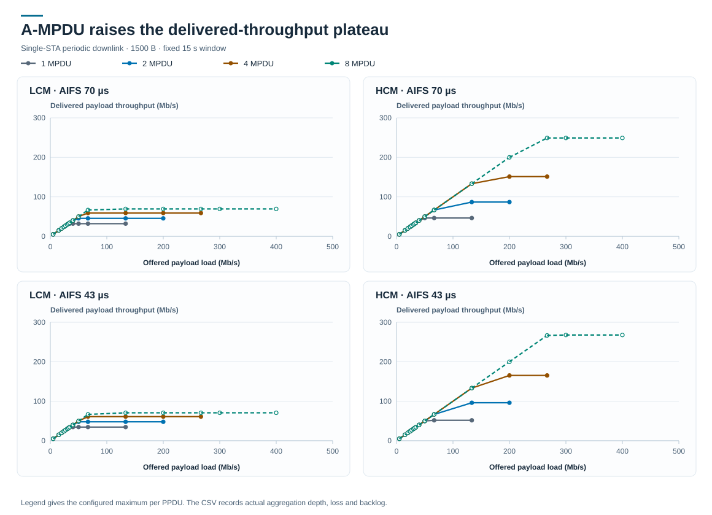
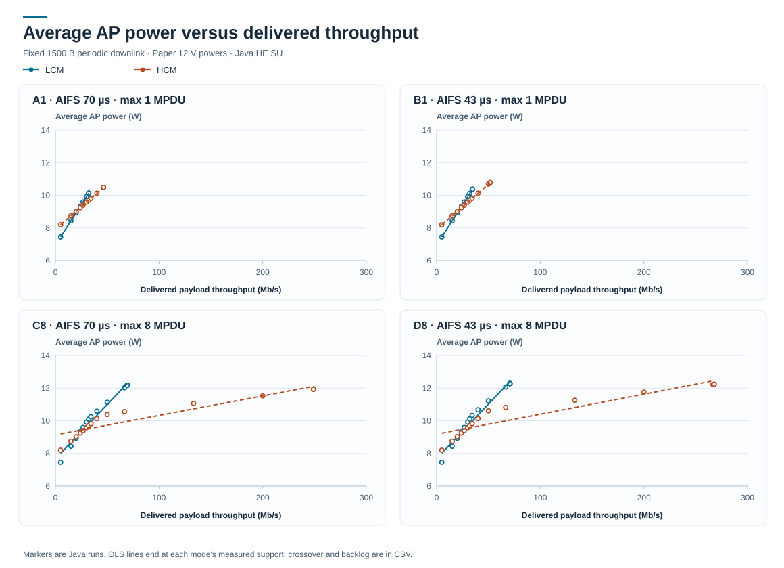
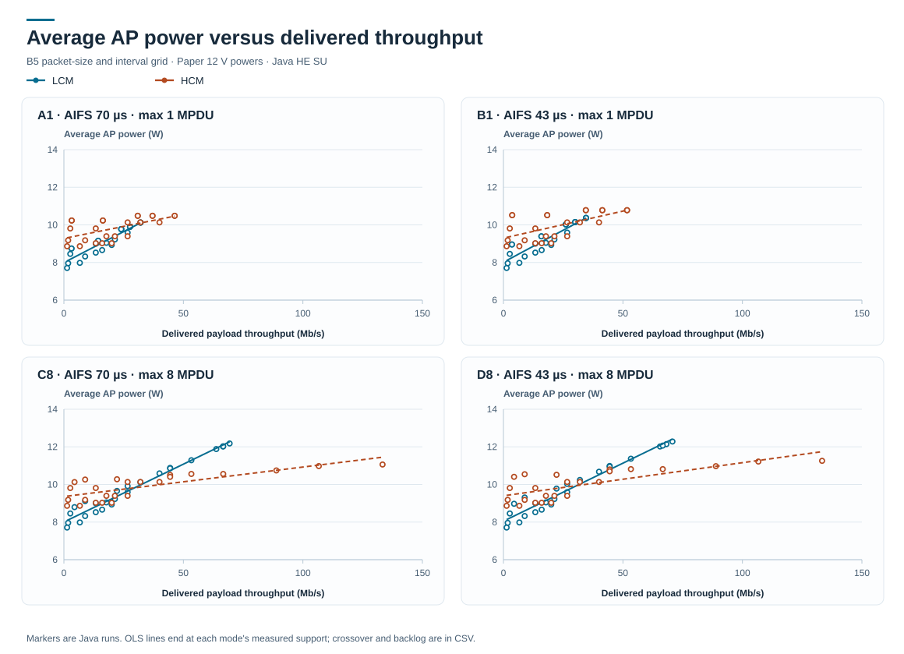

# B6 A-MPDU 聚合与静态模式能耗验证

## 配置与模型

| 配置 | 含义 |
| --- | --- |
| `wifi.mac.ampdu.enabled` | 默认 `false`。开启后使用 HE SU、EDCA 多 AC 和 DATA–SIFS–ACK 配置。 |
| `wifi.mac.ampdu.max-mpdus` | 最大 MPDU 数，默认 8，允许 1–64。上限为 1 或队首只有一个合格 MPDU 时执行原来的单帧立即 ACK。 |
| `wifi.mac.ampdu.max-bytes` | 最大聚合 APEP 字节数，默认 65535 B。含 MPDU、定界符及内部字节对齐。 |
| `wifi.mac.ampdu.first-attempt-error.packet.ids` | 实验专用的确定性子帧失败注入。给出的 ID 在首次被聚合发送且尚未重试时模拟解码失败。性能实验不开启此注入。 |
| `wifi.mac.edca.BE.aifsn` | B、D 场景设为 3，对应 43 μs。A、C 沿用 6，对应 70 μs。两者均使用 SIFS 16 μs 和 Slot 9 μs。 |

每次 EDCA 仲裁成功后，从对应发送设备、AC 的 FIFO 队首选取连续报文。同一 AC 映射为本模型中的一个 TID。遇到不同接收者或字节数、MPDU 数、PHY 时长上限时停止装载。待发送的数据只在 PPDU 起点装载。TXOP 为 0 时，一个竞争机会可承载一个聚合 PPDU，之后重新进入 AIFS 和退避。当前聚合配置要求所有 AC 的 TXOP Limit 为 0。

每个 MPDU 使用既有 MAC/FCS 开销和 4 B 定界符。默认每子帧的总开销为 34 B。非最后一帧补 0–3 B 使下一定界符按四字节对齐。最后一帧之后由现有 HE SU 的 LDPC、OFDM 符号取整和 PE 规则处理。整个 APEP 共用一套前导码和 PHY 编码。1500 B ×2 和 ×8 的 APEP 分别为 3070 B 和 12286 B。现有 5484 μs PPDU 时长限制也用于聚合。[IEEE 802.11ax-2021，§9.7、§26.4](https://doi.org/10.1109/IEEESTD.2021.9442429) · [ns-3 MPDU 聚合装载实现](https://github.com/nsnam/ns-3-dev-git/blob/master/src/wifi/model/mpdu-aggregator.cc)

数据结束后保留 SIFS，再发送 32 B、64 位位图的压缩 Block ACK。在 24 Mb/s 的 20 MHz non-HT OFDM 控制速率下，前导和 SIGNAL 为 20 μs，另需三个 4 μs 符号，合计 **32 μs**。对应的普通 14 B ACK 仍为 **28 μs**。本模型用 PPDU 内 MPDU 的位置作为位图索引，直接映射确认结果。[ns-3 控制帧与压缩位图序列化实现](https://github.com/nsnam/ns-3-dev-git/blob/master/src/wifi/model/ctrl-headers.cc)

接收端在 DATA 结束时交付通过解码的成员。发送端在 Block ACK 结束时移除成功成员，失败且未超限的成员按原相对顺序返回队首，按每包记录重试。收到至少一个正确认时复位 CW，全部失败时沿用竞争失败的 CW 增长口径。跨设备碰撞占用各自完整 PPDU 的 DATA 时长，发送设备等现有可配置的 ACK Timeout 后结算，所有未确认成员分别重试或丢弃。接收重排序缓冲、ADDBA 协商、Block ACK 本身的独立丢失和信道误包分布均超出当前模型。

下行 DATA 和 Block ACK 分别计入 AP TX、RX，上行方向相反。SIFS 和接入等待属于无线活动账本的 IDLE。信道忙时覆盖 DATA、SIFS 和响应，B2 对 AP 状态积分时只记一份帧活动。B3 读取固定窗口内的三种状态纳秒时长。

## 部分 Block ACK 实际事件

场景使用 4 个 1500 B 下行包，AIFS 43 μs，初始 CW 为 0。首轮故障注入 ID 2、4。窗口为 1000 μs，HCM 使用既有 B3 功率设定。[实际配置](../../configs/b6-ampdu-partial-ba.properties)

| 批次 | MPDU | DATA（μs） | Block ACK（μs） | 位图 | 结果 |
| --- | --- | --- | --- | --- | --- |
| 最初 DATA | 1、2、3、4 | 43.0–175.0 | 191.0–223.0 | `0x5` | 1、3 交付，2、4 保留并重试 |
| 重传 DATA | 2、4 | 266.0–357.2 | 373.2–405.2 | `0x3` | 2、4 交付 |

四包各交付一次。AP 在窗口内 TX **223.2 μs**、RX **64.0 μs**、IDLE **712.8 μs**，精确相加为 1000 μs。B3 总能耗为 **8331.936 μJ**。对照的 1500 B ×2，LCM/HCM DATA 长度为 342.4／91.2 μs，×8 为 1199.2／200.0 μs。[逐事件 CSV](../../results/b6-ampdu/ampdu-event-trace.csv) · [实际轨迹重建脚本](../../tools/verify_b6_ampdu_trace.py)

## 性能实验设计

- 拓扑为 1 MFU、1 SFU、1 STA，纯下行，BE 周期业务。光路使用 0 μs 固定时延。LCM 为 20 MHz／1 SS，HCM 为 80 MHz／2 SS，均使用现有 HE SU、MCS 7、GI 0.8 μs。ACK 控制速率 24 Mb/s，CWmin 15、CWmax 1023，TXOP 0。
- 1500 B 实验覆盖 A1、B1、C2、C4、C8、D2、D4、D8，各档从 5 Mb/s 起扫。聚合深度上限较大的配置额外缩短到达间隔，以观察吞吐量饱和，最大名义输入为 400 Mb/s。A1 和 B1 走原有单帧路径。开启后的最大深度为 1 单独在集成测试中与默认关闭作事件逐行对照。
- B5 网格实验保持 5 个包长 100／500／1000／1200／1500 B 和 5 个间隔 90／180／300／450／600 μs，覆盖 A1、B1、C8、D8。网格中的每次运行使用固定包长，汇总再跨包长拟合。两种实验中相同参数的运行复用同一份数据。
- 固定种子 101、生成及统计窗口 `[0, 15 s)`，每对 LCM/HCM 的源事件逐条校验一致。窗后排空用于区分显式丢包和窗口积压。时延分位数只使用窗内成功交付样本。
- 功率使用论文 12 V 换算值。LCM 的 IDLE／TX／RX 为 6.96／12.96／7.92 W，HCM 为 7.92／15.00／12.00 W。沿用 B2 实际状态时间，功率以 `Σ(P_s × T_s) ÷ 15 s` 计算。平均深度按所有在窗内开始的 PPDU 计算，含单帧退化为立即 ACK 的 PPDU。DATA、SIFS、控制帧占用分别按窗内交集统计。

投影器保留原始仿真事件的时间与包身份。每个性能用例独立对账 DATA、ACK/Block ACK 区间与 B2 的 TX、RX 时长，并校验 B3、源报文和最终交付守恒。吞吐量与成功比特能耗的分母只包括窗内交付。大量积压的模式可能在相同输入下交付较少，固定窗口总功率的差值需和实际吞吐量一起理解。[实验矩阵](../../configs/b6-ampdu-experiments.json) · [共同参数](../../configs/b5-paper-aligned.json) · [论文 §IV](https://doi.org/10.1109/MCOM.004.2400486)

## 固定 1500 B 的饱和吞吐量

下表的吞吐量是各配置在扫描中实测的最高窗内成功吞吐量。最右两列来自各配置的最高输入点，便于对照饱和时实际聚合和开销。

| 配置 | AIFS（μs） | 聚合上限 | LCM／HCM 吞吐量（Mb/s） | 最高输入点平均 MPDU/PPDU（LCM／HCM） | 每成功 MPDU 的控制帧时间（μs） |
| --- | ---: | ---: | ---: | ---: | ---: |
| A1 | 70 | 关闭 | 32.06／46.35 | 1.00／1.00 | 28.00 |
| B1 | 43 | 关闭 | 34.56／51.72 | 1.00／1.00 | 28.00 |
| C2 | 70 | 2 | 45.47／86.80 | 2.00／2.00 | 16.00 |
| C4 | 70 | 4 | 59.02／151.24 | 4.00／4.00 | 8.00 |
| C8 | 70 | 8 | 69.34／249.09 | 8.00／8.00 | 4.00 |
| D2 | 43 | 2 | 47.93／96.18 | 2.00／2.00 | 16.00 |
| D4 | 43 | 4 | 61.04／165.35 | 4.00／4.00 | 8.00 |
| D8 | 43 | 8 | **70.72／267.77** | 8.00／8.00 | 4.00 |

A1→B1 只缩短 AIFS，LCM/HCM 的峰值分别提高约 **7.8%／11.6%**。A1→C8 只打开聚合，峰值提高约 **116.3%／437.4%**。D8 最高输入为 400 Mb/s，LCM/HCM 平均 DATA PPDU 分别约 **1199.15／200.00 μs**，各需 16 μs SIFS 加 32 μs Block ACK。两模式窗口截止仍积压 **411596／165292 包**，说明此处的实测峰值来自持续饱和。低负载的报文在竞争结束时常常仍是单包，所配上限仅约束最多能够装入的数量。[饱和吞吐量及空口开销 CSV](../../results/b6-ampdu/saturation-comparison.csv)



## 平均功率与交叉点

两种模式分别以成功吞吐量为自变量做等权线性拟合。只接受落在两档实际观测吞吐区间交集内的交点。表中的低积压对照单独筛选同一个包长和间隔下两档都无丢包且窗末积压至多 1 包的配对，再重新拟合。这个筛选定义了扫描样本支持的低积压区间，区间上限也受离散采样点和窗末在途报文影响。

| 业务 | 配置 | 全样本交点（Mb/s） | LCM／HCM 全样本 R² | 配对低积压重拟合（Mb/s） | 共同低积压观测上限（Mb/s） |
| --- | --- | ---: | ---: | ---: | ---: |
| 固定 1500 B | A1 | 22.15 | 1.000／1.000 | 22.15 | 30.00 |
| 固定 1500 B | B1 | 22.15 | 1.000／1.000 | 22.15 | 32.00 |
| 固定 1500 B | C2 | 24.26 | 0.985／0.863 | 22.21 | 32.00 |
| 固定 1500 B | C4 | 25.80 | 0.976／0.821 | 22.21 | 32.00 |
| 固定 1500 B | C8 | 26.84 | 0.978／0.866 | 22.21 | 32.00 |
| 固定 1500 B | D2 | 24.55 | 0.985／0.867 | 22.19 | 34.29 |
| 固定 1500 B | D4 | 26.14 | 0.975／0.824 | 22.19 | 34.29 |
| 固定 1500 B | D8 | 27.39 | 0.976／0.859 | 22.19 | 34.29 |
| B5 多包长网格 | A1 | 31.87 | 0.858／0.362 | 23.41 | 26.67 |
| B5 多包长网格 | B1 | 32.56 | 0.840／0.382 | 23.41 | 26.67 |
| B5 多包长网格 | C8 | 29.53 | 0.965／0.599 | 26.75 | 32.00 |
| B5 多包长网格 | D8 | **30.61** | 0.952／0.569 | **25.64** | 32.00 |

12 个全样本交点均处于各自的共同观测范围内。B5 网格的 A1、B1 全样本交点超出了配对低积压观测上限。D8 的 30.61 Mb/s 在该组较宽的低积压观测范围内，但筛除主要过载样本后的拟合结果变为 25.64 Mb/s，且 HCM 低积压拟合 R² 仅约 **0.079**。多包长改变单位比特承担的前导、接入和控制帧开销，动态形成的聚合深度也随报文间隔变化。全样本的近似 31 Mb/s 对应该网格与当前拟合口径。固定包长在交点周围多数为单 MPDU，低积压拟合随聚合配置变化很小。[能耗交叉与服务范围 CSV](../../results/b6-ampdu/energy-crossover-comparison.csv)





交叉 CSV 同时记录拟合交点的功率，以及每档距离交点最近的实际点的输入、吞吐量、功率、时延、成功率和积压。最近点的时延与积压是直接观测值。B5 网格的最大输入约为 133.33 Mb/s，重聚合 HCM 的饱和吞吐量由固定包长扫描的额外高输入点确定。

以 D8 固定 1500 B、50 Mb/s 一组接近等交付的观测点为例，LCM/HCM 分别交付 **49.998／50.000 Mb/s**，平均功率 **11.218／10.611 W**，窗末积压 **3／0 包**，P99 **1.0176／0.3580 ms**。在 133.33 Mb/s 输入时，交付量变为 **70.719／133.330 Mb/s**，窗末积压约 **78268／4 包**。该高负载点用于衡量服务能力差异，功率比较同时注明各自成功交付量和能耗每比特。P95、P99 和成功率逐次保存。[逐次实验 CSV](../../results/b6-ampdu/per-run.csv) · [时延–吞吐量图](../../results/b6-ampdu/figures/delay-vs-throughput.svg)

## 验收与复现

- `mvn -o test` **404 项全部通过**，其中 A-MPDU 新增 31 项。覆盖默认关闭、上限 1 的原事件一致性、不同接收者和 AC、异长子帧填充、2／4／8 时长、部分 Block ACK、超限丢包、碰撞整批重传、上下行活动、AIFS 和实际功率积分。9 组光侧冻结用例也全部匹配。
- 实际 Java 执行 **380 次**，包含固定 1500 B 和 B5 网格的共用点。210 个逻辑配对在去重后为 190 个独立配对。所有运行通过逐条源输入校对、窗内帧时长对账和自然排空后报文守恒。
- 将 A1 网格与 B5 使用种子 101 的旧结果对照，50 条记录的原始负载、成功吞吐量、积压、平均功率、P99、AP 各状态时长和输入哈希一致。四份代表性 15 s 配置完整重放后，配置与日志投影哈希一致。[实际配置 ZIP](../../results/b6-ampdu/replay-configs.zip) · [运行清单及 JAR 哈希](../../results/b6-ampdu/experiment-manifest.json)

```powershell
mvn -o verify
python -B tools/verify_pon_final.py
python -B tools/verify_b6_ampdu_trace.py
python -B tools/run_b6_experiment.py --jobs 6
python -B tools/analyze_b6_ampdu.py
```

可用 `python -B tools/run_b6_experiment.py --smoke --jobs 2` 执行短测。生成可用于普通 JAR 的逐次配置时，可用 `--emit-configs` 并按需加变体和间隔筛选：

```powershell
python -B tools/run_b6_experiment.py --emit-configs target/b6-replay --variant D8 --interval-us 40
java -jar target/fttr-chap4-0.1.0-SNAPSHOT.jar target/b6-replay/D8-periodic-1500b-40us-101-hcm.properties
```

主要修改包括 `AmpduConfig`、`ConfigLoader` 和 `SimulationConfig` 的场景配置，`WirelessPhy`、`WifiLink` 和 `WifiFrameExchange` 的聚合与控制帧时长，`Sfu`、事件系统及日志的帧交换、记账和重试边界。新增专项测试及三个实验脚本，复用既有 B2/B3 功率与事件模型。
