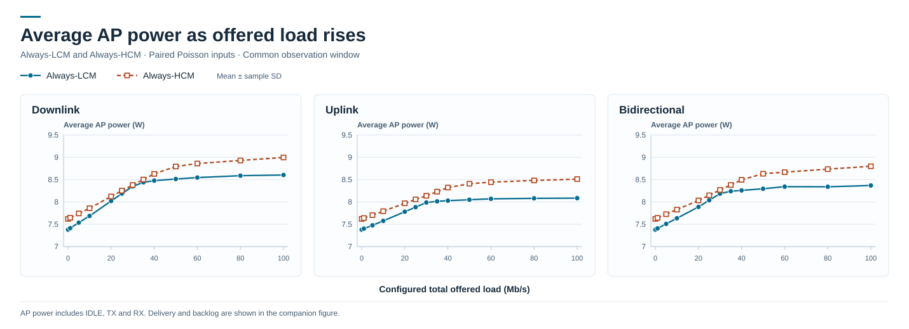
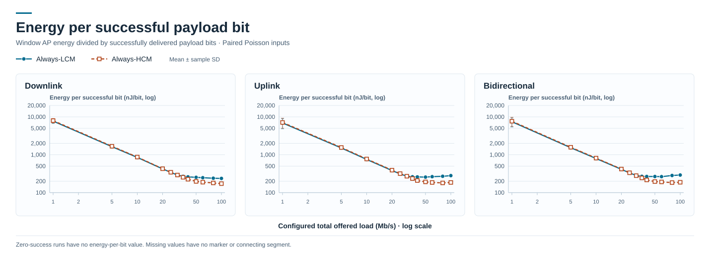
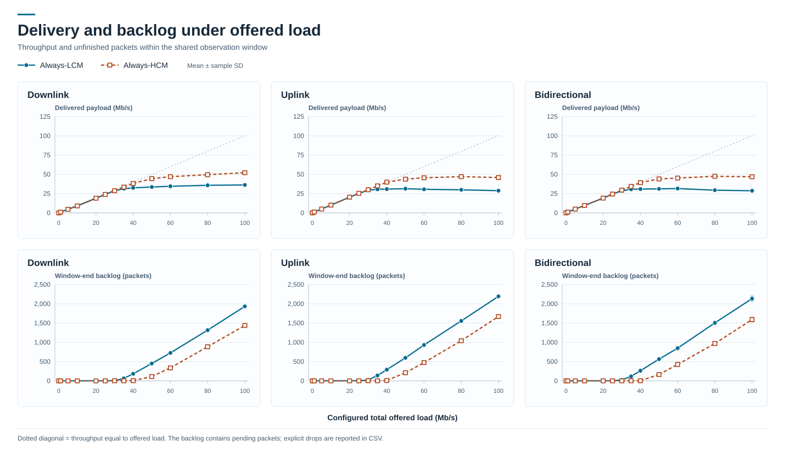

# B5 静态 LCM/HCM 功率与能耗交叉验证

在 B3 初始功率下，13 个负载点、3 个方向和 3 个种子的 **117 组固定窗口配对均由 LCM 消耗较少的 AP 总能量**。以成功比特衡量时，DL 在 30–35 Mb/s、UL 和双向在 25–30 Mb/s 出现均值换号。按相同完成包数结算能耗也得到相同区间，UL 在 30 Mb/s 的结果对种子敏感。这些区间对应本实验采样点，交叉位置及是否存在均取决于能耗口径和功率参数。

## 实验配置

| 项目 | 设置 |
| --- | --- |
| 拓扑 | 1 个 MFU、1 个 SFU、4 个固定关联 STA，共享一条无线接入资源 |
| 光侧 | 上、下行均采用现有固定 10 μs 单向时延抽象。本场景用于观察无线能力差异 |
| PHY | 802.11ax HE SU、MCS 7、GI 0.8 μs，LCM 20 MHz／1 SS，HCM 80 MHz／2 SS |
| 无线 MAC | EDCA 多 AC、DATA–SIFS–ACK、SIFS 16 μs、Slot 9 μs、ACK 24 Mb/s；ACK 超时 53 μs，最大重试 3 次，四类 TXOP 均为 0 |
| 业务 | 各源、各 AC 独立泊松，VO／VI／BE／BK 各占对应源的 25%，均为 1200 B |
| 方向 | DL 由 MFU 注入，目标随机选取。UL 在 4 台 STA 之间均分。双向输入各占总负载的 50%，上行部分再按 STA 均分 |
| 名义总负载（Mb/s） | 0、1、5、10、20、25、30、35、40、50、60、80、100 |
| 种子与配对 | 101、202、303 为 EDCA 种子。DL 源种子为 `100 × seed`，UL 源为 `100 × seed + staId` |
| 业务与观察窗口 | 生成和固定统计窗口均为 `[0, 300000 μs)`，从空队列开始。窗口后继续运行至自然排空，用于追踪未完成报文 |
| AP 功率 | B3 `RESEARCH_INITIAL_V1`。LCM 的 IDLE／TX／RX 为 7.38／9.20／8.20 W，HCM 为 7.62／10.50／8.70 W |
| 模式 | Always-LCM、Always-HCM，B4 关闭 |

每个方向、负载和种子用两份配置运行，总计 234 次 Java 仿真。仿真日志逐包比对 ID、生成纳秒、大小、方向、AC 和目标或源 STA，确认 117 对输入完全一致。CSV 附带输入、配置及完整 Java 日志的 SHA-256。负载横轴采用配置值，实际输入速率另列在指标表中。功率范围限于 SFU 的 AP，功率参数的来源与硬件限制见 [B3 验证报告](../ECQ_SDPS_B3_AP_Energy.md)。

## 指标与比较口径

1. **同输入、同窗口。** 以 B2 实际 IDLE、TX、RX 区间核算 B3 能耗，`E(μJ) = Σ P_s(W) × T_s(ns) / 1000`，平均功率为 `E / 300000 μs`。每次核对三状态恰好覆盖窗口，且分量、总能耗与 Java B3 汇总一致。
2. **窗口内成功交付。** 以 STA（DL）或 MFU（UL）的 `DELIVERED` 事件计数。吞吐量为窗内成功比特除以观察时间，单位成功比特能耗为 `1000 × E(μJ) / 成功比特数`，单位 nJ/bit。空载时无成功比特，该比值和时延分位数留空。
3. **相同完成业务量。** 仅考虑在固定窗口内已到达目标端、且 ACK 已结束的报文。每对取两模式中较小的完成包数 `N`，分别积分到两模式各自第 `N` 个完整成功交换的结束时刻，包含该包的 ACK。脚本另外验证两模式截至各自终点均恰好交付 `N` 包。此口径固定成功比特量，允许所需时间不同。两种模式可先交付不同 ID。双向交付方向比例也可不同，例如在 30 Mb/s 三个配对中，下行占比差距在 0.67 个百分点以内，80 Mb/s 一个配对达到 7.00 个百分点。逐次 CSV 记录该前缀内的 DL／UL 完成量。
4. **时延与丢包。** P95/P99 用窗内成功交付时间减生成时间，按 nearest-rank 求每次实验的分位数，再对三个种子求均值。低样本标记按 P95 少于 20 包、P99 少于 100 包设置。未完成和已丢包样本不进入分位数，高负载时可能改变成功样本构成。
5. **窗末积压与最终丢包。** 窗末积压为已生成且在窗口截止前既未成功交付也未被显式丢弃的包，涵盖排队和在途。显式丢包以 Java 的重试超限事件为准。现有配置沿用无限队列，积压分开统计。窗末后继续记录交付与丢弃，234 次运行在自然结束时均满足生成量等于交付量加显式丢包量。

图中点为三个种子的均值，误差条为跨种子的样本标准差。交叉区间用相邻实测负载处的均值换号判定，同时保留端点的逐种子差值。这里的区间不做插值定位。

## 功率、交叉与吞吐表现





空载平均功率为 7.38／7.62 W（LCM／HCM）。B3 配置下，0–100 Mb/s 的已采样点没有固定窗口总能耗交叉。三方向的平均功率差 `HCM − LCM` 都在 30 Mb/s 取到各自最小值，分别为 DL **+0.0302 W**、UL **+0.1505 W**、双向 **+0.0832 W**。HCM 同时有更高的空闲功率和更短的 DATA 时间。在过载点，HCM 完成的业务量更大，整窗功率差同时反映真实收发活动和业务服务能力。

| 方向 | 固定总能耗交叉 | 单位成功比特交叉（Mb/s） | HCM−LCM 在区间两端（nJ/bit） | 等完成包数的能耗差在同一区间两端（μJ） |
| --- | --- | --- | ---: | ---: |
| DL | 未观察到 | 30–35 | +0.498 → −14.419 | +5997.928 → −128262.344 |
| UL | 未观察到 | 25–30 | +5.796 → −0.608 | +46267.847 → −0.708 |
| 双向 | 未观察到 | 25–30 | +4.401 → −5.105 | +30382.120 → −31360.624 |

在这些端点，DL 与双向两种能效口径的换号均得到三个种子支持。UL 的 30 Mb/s 端点两个种子为负、一个为正，等完成包数能耗的均值接近持平。到 35 Mb/s，UL 的三个种子均呈现 HCM 较低的单位成功比特能耗和等完成量能耗。固定窗口总能耗较低的 LCM 在过载时完成更少业务，不能单凭该列的差值归因于服务同等工作量的节能。



下表均以 **LCM／HCM** 表示三种子均值，延迟分位数只统计窗内成功交付。

| 方向 | 输入（Mb/s） | 吞吐量（Mb/s） | P95（ms） | P99（ms） | 窗内显式丢弃（包） | 窗末积压（包） |
| --- | ---: | ---: | ---: | ---: | ---: | ---: |
| DL | 35 | 31.39／33.42 | 56.53／1.55 | 72.48／2.83 | 0／0 | 65.0／1.7 |
| UL | 35 | 30.56／34.99 | 96.65／2.70 | 143.53／6.21 | 0.7／0 | 140.0／2.3 |
| 双向 | 35 | 30.58／34.28 | 40.57／2.02 | 99.79／4.51 | 1.0／0 | 117.0／2.3 |
| DL | 50 | 33.58／44.44 | 113.49／63.79 | 190.31／81.46 | 0／0 | 451.3／112.0 |
| UL | 50 | 31.36／43.75 | 125.10／90.43 | 192.50／146.84 | 2.7／1.0 | 597.0／211.3 |
| 双向 | 50 | 31.15／44.09 | 68.80／47.85 | 198.63／113.52 | 6.0／1.0 | 564.0／164.7 |
| DL | 100 | 36.23／52.11 | 143.52／24.72 | 162.21／196.83 | 0／0 | 1933.7／1437.7 |
| UL | 100 | 28.79／45.87 | 149.70／47.48 | 211.57／85.08 | 44.3／33.3 | 2192.7／1670.0 |
| 双向 | 100 | 28.70／46.86 | 124.90／85.71 | 196.11／181.06 | 48.0／24.7 | 2135.3／1591.3 |

**LCM 在 UL 和双向 30 Mb/s 已出现显著尾时延抬升，在 35 Mb/s 三种方向都出现积压。** HCM 到 50 Mb/s 同样出现明显积压。在本次扫描中，LCM 的最高三种子平均吞吐量按 DL、UL、双向依次为 36.23、31.36、31.56 Mb/s，HCM 为 52.11、47.00、47.45 Mb/s。这些是指定业务和观察窗口下的实测峰值。高负载下只有窗内成功样本进入分位数，例如 HCM 下行 P95 在 80→100 Mb/s 从 134.83 ms 降到 24.72 ms，同期积压却从 886 包升到约 1438 包。该下降不足以认定排队改善。

## 功率参数敏感性

使用每次 Java 仿真的原始状态时长和等完成量前缀，对 HCM 的 IDLE 功率分别增减 0.12 W，或将 HCM 的 TX 和 RX 同时乘以 0.9 或 1.1。每次只改上述一组系数，LCM 和实际服务轨迹固定。表内区间单位为 Mb/s。

| HCM 功率设定 | 固定窗口总能耗换号区间 | 单位成功比特换号（DL／UL／双向） | 等完成包数总能耗换号（DL／UL／双向） |
| --- | --- | --- | --- |
| B3 默认 | 无 | 30–35／25–30／25–30 | 30–35／25–30／25–30 |
| IDLE −0.12 W | DL 20–25、35–40，UL／双向无 | 10–20／25–30／25–30 | 20–25／25–30／25–30 |
| IDLE +0.12 W | 无 | 30–35／30–35／25–30 | 30–35／30–35／25–30 |
| TX/RX ×0.9 | 三种方向均为 10–20 | 10–20／10–20／10–20 | 10–20／10–20／10–20 |
| TX/RX ×1.1 | 无 | 30–35／30–35／30–35 | 30–35／30–35／30–35 |

HCM 空闲功率下调 0.12 W 时，DL 的固定窗口能耗在 25、30、35 Mb/s 三个采样点低于 LCM，40 Mb/s 又高于 LCM。两次换号均得到三个种子支持，说明即使出现交叉，也可能形成一个负载区间。HCM 的 TX/RX 同降 10% 则在三方向都出现固定窗口交叉，说明当活动功率的估计变化时，B3 默认参数下的“无固定窗口交叉”结论可改变。该敏感性只对已有 Java 活动时长重新积分，反映功率常数的影响。

## 复核文件与运行

从仓库根目录执行。Python 脚本使用标准库处理日志、统计和生成 SVG。

```powershell
mvn -o "-Dmaven.test.skip=true" package
python -B tools/run_b5_ap_energy_load.py --jobs 5
```

- 负载、种子及共同参数见[实验矩阵](../../configs/b5-energy-load.json)，每次 Java 运行用到的完整配置见 [234 份配置归档](../../results/b5-energy-load/test-configs.zip)和[运行清单](../../results/b5-energy-load/experiment-manifest.json)。
- 每次运行的功率、时延、吞吐、丢包、积压、等完成业务量及核对信息见[逐次指标 CSV](../../results/b5-energy-load/energy-load-metrics.csv)和[跨种子汇总 CSV](../../results/b5-energy-load/energy-load-aggregate.csv)。
- 交叉证据和逐种子差值见[基线交叉区间](../../results/b5-energy-load/energy-crossover-intervals.csv)、[逐负载功率敏感性](../../results/b5-energy-load/power-sensitivity.csv)及[敏感性交叉区间](../../results/b5-energy-load/power-sensitivity-crossovers.csv)。
- [仿真重放与日志校验](../../tools/run_b5_ap_energy_load.py)、[统计与敏感性计算](../../tools/analyze_b5_energy_load.py)、[绘图](../../tools/plot_b5_energy_load.py)支持独立复核。需要单次原始事件时，从配置归档提取对应文件并作为 JAR 的配置参数运行。日志哈希与 CSV 同列提供。

实验采用单 SFU 隔离场景，功率、交叉和积压结果的适用范围是当前固定 PHY、独立信道、业务构成、报文长度、B3 功率假设及 300 ms 观察窗口。
