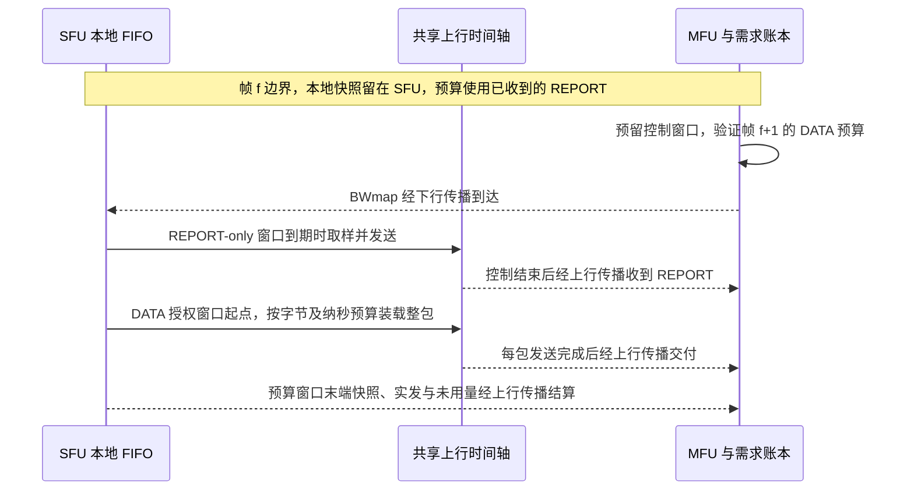
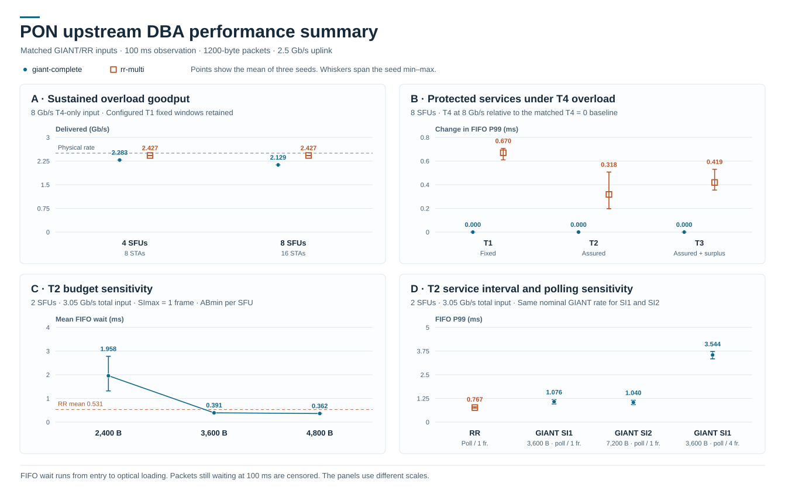

# FTTR 基础版 PON 与 DBA 技术报告

## 1. 拓扑与链路职责

仿真以一个 MFU 和多个固定关联的 SFU/STA 为拓扑。下行由 MFU 按目的 STA 解析目标 SFU，光侧交付后由 SFU 进入现有无线发送流程。上行由 STA 发往关联 SFU，SFU 成功接收无线 DATA 后立即交给光侧队列，原无线流程继续完成 SIFS 和 ACK。光侧传输资源与 Wi-Fi 信道占用分别记账。共享 PON 的下行发送器与上行时间轴互相独立，同一时刻允许两个方向各有一笔传输。

| 模块 | 职责 |
| --- | --- |
| `Mfu`、`Sfu`、`Simulator` | 转发与送达、STA–SFU 关联、事件分发、控制状态更新 |
| `PonDownlink` | MFU 的单个共享下行 FIFO 与串行发送器 |
| `PonUplink`、`PonUplinkScheduler` | 每 SFU 上行端口、FCFS 队首仲裁、帧边界、控制时隙和 DATA 执行 |
| `PonUplinkReport`、`PonDemandLedger` | 不可变本地快照、MFU 最新已收报告与预约／结算账本 |
| `TcontTopology`、`TcontProfile` | 物理 SFU 与逻辑 Alloc-ID 的归属、业务映射和 SI/AB 参数 |
| `DbaContext`、`DbaPolicy`、`DbaPlan`、`DbaPlanValidator` | 构造 MFU 可见的只读输入、产生预算、验证并预览目标帧窗口 |
| `PonDbaGrant`、`PonGrantPacketFiller` | 真实预算状态、SFU 本地整包选择与结算 |

源代码入口包括 [MFU](../../src/main/java/edu/suda/fttr/entity/Mfu.java)、[SFU](../../src/main/java/edu/suda/fttr/entity/Sfu.java)、[下行共享链路](../../src/main/java/edu/suda/fttr/link/PonDownlink.java)、[上行共享链路](../../src/main/java/edu/suda/fttr/link/PonUplink.java) 和 [离散事件队列](../../src/main/java/edu/suda/fttr/simulator/EventQueue.java)。

## 2. 光侧传输、帧与事件时钟

共享光链路使用整数纳秒作为内部时钟，外部配置的时间单位是 μs。两方向均使用同一个串行化函数。若报文大小为 `B` 字节，速率为 `R` Mb/s，则串行化时长是 `ceil(8000 × B / R)` ns。输入速率可为正十进制数，正报文至少占 1 ns。`1200 B` 在下行 `10000 Mb/s` 占 `960 ns`，在上行 `2500 Mb/s` 占 `3840 ns`。下行共享 FIFO 的报文在发送器空闲时开始发送，发送结束于开始时刻加串行化时长，目标 SFU 到达时刻再加下行传播时延。报文开始传播后，下一包即可使用发送器。`fixed` 模式直接以 `fiber.delay.us` 表示 DATA 链路时延。 [串行化函数](../../src/main/java/edu/suda/fttr/link/PonLinkTiming.java)

上行 `pon-shared` 按各 SFU 队首的入队时刻执行全局 FCFS，同刻由插入序号打破平局。只有共享发送器空闲才能安排下一包，传播阶段可与下一包串行化重叠。上行 `pon-framed` 的第 `f` 帧为半开区间 `[f × P, (f + 1) × P)`，其中 `P` 默认 `125000 ns`。同一帧中的 DATA 与控制时隙按绝对纳秒排列，允许前一窗口结束与后一窗口开始同刻，同一时刻最多一个物理传输。事件队列按时钟、事件等级及插入顺序确定先后，真实 DBA 的 DATA 完成事件在同刻下一次占用之前释放资源。

分帧 FCFS 只考虑 `enqueueNs < frameStartNs` 的报文。队首放不进当前帧剩余窗口时，留到下次调度，队尾不能越过。超过整个帧容量的输入报文在配置校验时拒绝。关闭 BWmap 时，在当前帧安排报文。开启 BWmap 时，在帧 `f` 边界预约 `f+1`，已预约的报文在此时移出待授权队列。SFU 只有收到授权且到达发送时刻才发送。两条光路传播时延分别建模，同一方向使用统一值。 [FCFS 与帧调度](../../src/main/java/edu/suda/fttr/link/PonUplink.java#L346)

## 3. REPORT、BWmap 与 MFU 需求账本

### REPORT 的三个来源

| 路径 | SFU 取样 | MFU 可见时刻 |
| --- | --- | --- |
| 分帧 FCFS 的 DATA 捎带 | 分配前的帧边界。同一帧每 SFU 的第一条 DATA 授权携带快照 | 首包发送结束加上行传播时延。没有分配时隙时，该份边界快照仅保留在本地 |
| REPORT-only | SFU 执行控制窗口时取样，空队列可报告 `0 B` | 控制时隙结束加上行传播时延 |
| 真实 DBA 的 DATA 结算 | 预约窗口末端取样，同时记录实际发送量和未用预算，即使实际装载为零 | 预算窗口结束加上行传播时延 |

快照保存帧号、对象、时刻和缓存包数／字节数。`pending` 是拍摄时仍留在本地 FIFO 的内容。在 FCFS 中已逐包预约者已离开 FIFO。真实 DBA 只在执行时取出装载报文，因此一个未来预算覆盖的包可以仍留在快照内。`eligible` 是该时刻前严格早于采样边界入队的部分。同刻入队可以出现在 `pending`，`eligible` 仍按严格不等式计算。真实 DBA 的周期性边界快照仅用于本地观察。MFU 按可见 REPORT 的 `pendingBytes` 估算需求。

REPORT 生成、送达、应用分别发生。MFU 只从收到的报告更新状态，先比较原始快照时刻，同刻才比较帧号。首份报告到达前是 `UNKNOWN`。已知 `0 B` 和已知正需求使用同一个已知状态及不同的字节值。`REPORT Age = decisionNs − snapshotNs`，包括等待 MFU 接收及稍后决策的时间。 [MFU 报告接收](../../src/main/java/edu/suda/fttr/entity/Mfu.java#L93)

### 授权传播与结算

在帧 `f` 边界，先在 `f+1` 的起点预留到期的 REPORT-only 窗口，再规划 DATA。控制轮询基于已关联 SFU 顺序，开启 T-CONT 时按配置中的 SFU、Alloc-ID 顺序，对每个对象独立轮询。每个到期帧只轮询一个对象，`64 B` 在默认上行速率下占 `205 ns`。若每 `K` 帧轮询一次、拓扑有 `N` 个轮询对象，则同对象的轮询机会相隔 `N × K × P`。结算报告可在该周期之间另外到达。

BWmap 是逻辑下行信息，`grantRxNs = grantTxNs + downPropagationNs`，接收必须严格早于时隙起点。DATA 预算由 MFU 以 `(Alloc-ID, SFU, 目标帧, 字节, 开始, 结束)` 标识，另给独立授权 ID。真实 DBA 使用 `PonGrantPacketFiller` 在窗口起点从当时的本地 FIFO 原子装载连续队首整包。每加一包同时检查总字节上限及逐包取整的串行化总时长。队首放不进时停止，余量在原窗口内保留。本地装载可以用已在窗口起点入队的包，MFU 规划仍只用决策时可见的报告估计。包的 MFU 到达时刻为各自发送结束加上行传播时延。窗口结束快照和使用量均经结算事件到达 MFU。

令 `S` 为最新已收 REPORT 的快照时刻，`t` 为查询时刻。MFU 的需求估计为 `max(0, pendingBytes − D)`。FCFS 的逐包授权中，`D` 包含 `[S, t]` 创建的 DATA 预约。同帧先取样再授权，所以创建时刻和 `S` 相同的预约也扣减。真实 DBA 的预算中，`D` 只考虑已创建且时隙起点晚于 `S` 的 DATA 预约，在结算到达前扣完整预算，到达后改扣实发字节。若时隙已在快照时刻装载，快照已反映这次出队，账本不再扣这笔。报告从 `S` 到 MFU 可见之间创建的预算也参与计算。REPORT-only 窗口占时间，DATA 需求账本不扣控制字节。 [需求账本](../../src/main/java/edu/suda/fttr/entity/PonDemandLedger.java) · [真实装载](../../src/main/java/edu/suda/fttr/link/PonUplink.java#L538)

## 4. DBA 模式与 T-CONT 服务

| `fiber.uplink.dba.mode` | 决策与执行规则 |
| --- | --- |
| `fcfs` | 默认。共享或分帧 FCFS 直接选择队首完整报文。可观察 REPORT、BWmap、需求账本和轮询，需求估计不改变其挑选顺序。 |
| `shadow-rr` | 根据 MFU 已知需求和可用纳秒计算至多一笔建议。校验、记录后，实际 DATA 仍由分帧 FCFS 授权。 |
| `rr` | 至多选择一个可用对象并生成实际 DATA 预算。 |
| `rr-multi` | 按轮转顺序遍历对象，每个对象至多一笔。每生成一笔扣除其向上取整后的真实纳秒，再分给下一对象。 |
| `giant` | Type 2/3/4 基线。执行保障、非保证、尽力而为服务，允许同帧多个对象，但本对象有未结算预算时跳过动态授权。 |
| `giant-complete` | 多对象真实执行，支持 Type 1–5、四个阶段、保障准入及不同目标帧的流水预算。 |

RR 以 SFU、Alloc-ID 升序形成固定环。对 `UNKNOWN`、已知零需求和有未结算真实预算的对象跳过。预算取已知有效需求与剩余帧容量较小者，字节容量为 `floor(remainingNs × R / 8000)`。`rr` 获得一笔后推进到下一对象，`rr-multi` 移至本轮最后获预算对象的下一位，无预算则不移动。RR 使用同一组队列与授权流程，T-CONT 的 SI/AB 参数不改变 RR 的分配次序或预算。 [单预算 RR](../../src/main/java/edu/suda/fttr/dba/RoundRobinDbaPolicy.java) · [多预算 RR](../../src/main/java/edu/suda/fttr/dba/MultiGrantRoundRobinDbaPolicy.java)

开启 T-CONT 后每个 Alloc-ID 有独立 FIFO、REPORT、需求账本、预算与结算。`sfuId` 标识物理归属，`allocationId` 标识服务对象。每台 SFU 的 VO、VI、BE、BK 必须恰各映射一次。多个 AC 可共用一个 T-CONT，类型与 AC 的对应关系由场景决定。关闭 T-CONT 时，每台 SFU 一个兼容对象，逻辑 ID 为 `2 × sfuId`。 [T-CONT 拓扑](../../src/main/java/edu/suda/fttr/dba/TcontTopology.java)

| Type | 固定 | 保障 | 非保证 | 尽力而为 |
| --- | --- | --- | --- | --- |
| 1 | SI-fixed / AB-fixed | — | — | — |
| 2 | — | SImax / ABmin | — | — |
| 3 | — | SImax / ABmin | SImin / ABsur | — |
| 4 | — | — | — | SImin / ABsur |
| 5 | SI-fixed / AB-fixed | SImax / ABmin | SImin / ABsur | SI-BE / AB-BE |

每项业务阶段从配置 SI 开始独立计数。`0` 为未启用，`>1` 时本帧递减，`1` 表示本轮可服务。固定和保障阶段到期后恢复到配置 SI，非保证与尽力而为阶段只有本轮获得正预算才恢复周期，其余保留到期状态。固定阶段按配置额度预约，即使当时为 `UNKNOWN` 或 FIFO 为空。保障、非保证、尽力而为按阶段顺序分配，后一阶段扣除本轮同对象已分配额度，并继续受 MFU 已知净需求与帧剩余容量限制。固定与保障按类型、Alloc-ID 定序。两个剩余阶段独立轮转，`giant-complete` 遇容量受限时，下轮从本轮首个获正预算对象之后开始。

同一对象的阶段额度合并为一笔正预算，追加 `ΔB` 字节时只消耗 `T(B + ΔB) − T(B)` 纳秒。计划中的窗口按对象首次获正预算的顺序排列，阶段优先级是预算决策顺序。保守 SLA 准入将全部固定与保障额度视为同帧到期，求和 `Σ T(AB-fixed + ABmin_assured) + T(pollBytes)`，超过帧长即拒绝启动。准入通过表示预约容量可行，实际业务还受报告可见性、整包装载、输入和时窗限制。流水预算允许同一 Alloc-ID 在不同且不重叠的未来窗口有多笔未结算授权，已知净需求继续扣相关预约。Type 5 四组件和流水账本是项目扩展。所采用的 GIANT 与 X-GIANT 参考规则、算法差异及逐事件证据见 [GIANT 策略](../../src/main/java/edu/suda/fttr/dba/GiantDbaPolicy.java) 和 [第 18 步完整策略](18-giant-completion-test.md)。

`DbaContext` 只包含当前决策时刻、目标帧、速率、帧周期、控制预留及各对象的拓扑、报告与账本状态。`DbaPlanValidator` 校验归属、同帧对象唯一、字节与时长、已知需求、固定额度、帧容量和窗口重叠，返回只读窗口。动态授权在计划校验后才由上行执行层物化成真实 BWmap。 [上下文](../../src/main/java/edu/suda/fttr/dba/DbaContext.java) · [计划校验](../../src/main/java/edu/suda/fttr/dba/DbaPlanValidator.java)

## 5. 配置键、默认值与依赖

下表列出光侧配置所用的完整键名。传播与帧周期可以写小数 μs，必须能精确换算为整数纳秒。速率为正十进制 Mb/s。布尔开关接受 `true` 或 `false`。

| 键 | 缺省 | 单位与约束 |
| --- | --- | --- |
| `fiber.delay.us` | 无数值缺省 | 非负整数 μs。两方向均为固定或有业务使用固定方向时需提供。 |
| `fiber.downlink.mode` | `fixed` | `fixed`、`pon-shared`。 |
| `fiber.downlink.rate.mbps` | `10000` | 仅下行 `pon-shared`。 |
| `fiber.downlink.propagation.us` | `0` | 非负 μs，下行共享 DATA 或启用 BWmap 时用作传播时间。固定 DATA 仍用 `fiber.delay.us`。 |
| `fiber.uplink.mode` | `fixed` | `fixed`、`pon-shared`、`pon-framed`。 |
| `fiber.uplink.rate.mbps` | `2500` | 上行 `pon-shared` 或 `pon-framed`。 |
| `fiber.uplink.propagation.us` | `0` | 非负 μs，上行 `pon-shared` 或 `pon-framed`。 |
| `fiber.uplink.frame.period.us` | `125` | 正 μs，仅 `pon-framed`。 |
| `fiber.uplink.report.enabled` | `false` | `pon-framed` 的快照与报告路径开关。 |
| `fiber.uplink.bwmap.enabled` | `false` | 仅 `pon-framed`，启用时下行控制传播严格小于帧周期。 |
| `fiber.uplink.demand.ledger.enabled` | `false` | 仅 `pon-framed`，有已收 REPORT 时才可推算已知需求。 |
| `fiber.uplink.poll.enabled` | `false` | 要求 `pon-framed`、REPORT、BWmap。 |
| `fiber.uplink.poll.bytes` | `64` | 启用轮询时生效，正整数 B，其串行化时长不得超过帧周期。 |
| `fiber.uplink.poll.interval.frames` | `1` | 启用轮询时生效，正整数帧数。首次决策边界是帧 1。 |
| `fiber.uplink.poll.end.us` | 启用轮询时必填 | 正 μs，严格大于帧周期。只有边界时刻小于该值才创建轮询或真实 DBA 预算，已授权数据可在该时刻之后完成。普通 FCFS 的 DATA 可按积压继续。 |
| `fiber.uplink.dba.mode` | `fcfs` | 其余模式均要求 `pon-framed`、REPORT、BWmap、账本与有限轮询。 |
| `fiber.uplink.tcont.enabled` | `false` | 要求真实 `rr`、`rr-multi`、`giant` 或 `giant-complete`。两个 GIANT 模式都必须开启 T-CONT。真实 DBA 超过 2 台 SFU 时必须开启。 |
| `fiber.uplink.tcont.alloc.ids` | 开启 T-CONT 时必填 | 逗号分隔的全网唯一正整数 Alloc-ID。每个条目均有对应属性。 |

拓扑、业务输入和光无线交接的配置如下。表中的 `<源>` 在下行取 `traffic.sfu.<id>`，在上行取 `traffic.sta.<id>`，可用 `<源>.class.<AC>` 为某类业务单独指定速率和包长。`<AC>` 为 VO、VI、BE、BK。

| 键 | 缺省 | 单位与含义 |
| --- | --- | --- |
| `sfu.count`、`sta.count` | 各为 `1` | 正整数，设备 ID 从 1 编号。 |
| `sta.<id>.sfu.id` | `1` | 该 STA 已配置的固定关联 SFU。 |
| `traffic.mode`、`traffic.direction` | `manual`、`DL` | 手动或 `poisson`，方向可设 `DL`、`UL` 或 `BOTH`。 |
| `packet.arrival.us` | 手动模式必填 | 非负整数 μs 列表，表示在源节点生成。 |
| `packet.bytes`、`packet.<n>.bytes` | 逐包须有有效值 | 正整数 B，逐包值覆盖共有值。 |
| `packet.<n>.sta.id`、`packet.<n>.type` | `1`、`BE` | 上行的源或下行的目的 STA，以及业务类。 |
| `packet.<n>.direction` | 从单向配置继承 | `BOTH` 时逐包填写 `UL` 或 `DL`。 |
| `traffic.duration.us`、`<源>.duration.us` | 泊松模式前者必填，后者继承 | 正整数 μs，流的截止时间不得晚于公共窗口。 |
| `<源>.rate.pps` / `rate.mbps` | `0` | 包/s 或 Mb/s，任选一个单位。可用类别前缀构成独立流。 |
| `<源>.packet.bytes` | 正速率时必填 | 正整数 B。独立类别流在类别前缀内设置。 |
| `<源>.seed` | 正速率时必填 | 有符号 64 位整数。独立类别流仍读同一源的种子。 |
| `<源>.class.weights` | `0,0,1,0` | 四类非负权重，至少一项大于 0，只用于总速率模式。 |
| `wifi.model`、`wifi.delay.us` | 有时延键时推导为 `fixed`，否则为 `he-su` | 固定模型需提供非负整数 μs。HE SU 的 PHY 参数由无线侧配置。 |
| `wifi.mac.access`、`wifi.mac.exchange` | `fixed-priority`、`data-only` | 决定无线争用和 DATA 交换时序。成功的上行 DATA 完整到达 SFU 后进入光侧。 |

可执行配置见 [双向 Type 1–5](../../configs/pon-final-dba.properties)、[共享下行](../../configs/pon-shared-downlink.properties)、[共享上行](../../configs/pon-shared-uplink.properties) 和 [完整 GIANT QoS](18-giant-completion-test.md)。完整的无线 PHY 和 EDCA 参数见 [README](../../README.md)。

每个 Alloc-ID 的键置于 `fiber.uplink.tcont.alloc.<id>.` 下。

| 后缀 | 取值 |
| --- | --- |
| `sfu.id` | 已配置的正整数 SFU ID。 |
| `type` | 整数 `1` 到 `5`。`giant` 只接受 Type 2–4。 |
| `classes` | 非空的 VO、VI、BE、BK 逗号列表。每台 SFU 必须覆盖四类且互不重复。 |
| `si.max.frames`、`ab.min.bytes` | Type 2/3/5 为正且必填。Type 4 的 `SImax` 必填且为正、`ABmin` 必填且非负，两者均为兼容字段。Type 1 可省略或填 `0`。 |
| `si.min.frames`、`ab.sur.bytes` | Type 3/4/5 为正且必填。Type 1/2 可省略或填 `0`。 |
| `si.fixed.frames`、`ab.fixed.bytes` | Type 1/5 必填且均为正。Type 2–4 不接受这两个键。 |
| `si.be.frames`、`ab.be.bytes` | Type 5 必填且均为正。Type 1 可省略或填 `0`。Type 2–4 不接受这两个键。 |

SI 为整数帧数，AB 为整数字节。SImax 与 SImin 分别对应不同的服务角色，本模型没有在两者之间施加大小顺序。配置校验还拒绝未列入 `alloc.ids` 的属性、未知角色、类型和无法装入完整上行帧的报文。 [配置加载器](../../src/main/java/edu/suda/fttr/config/ConfigLoader.java) · [类型校验](../../src/main/java/edu/suda/fttr/dba/TcontProfile.java)

## 6. 指标口径与模型边界

- **共享容量。** 上行物理忙时为实发 DATA 时长与实际 REPORT-only 发送时长之和。预约占用另外包括空固定窗口和 DATA 预算未用时长，传播与逻辑 BWmap 不占 DATA 发送时间。`PON_UPLINK` 的内置 DATA 利用率分母为仿真起点至最后一个事件，`PON_UPLINK_FRAMES` 按帧计入轮询忙时。实验按注明的共同观察窗剪裁事件，吞吐用窗内 MFU 实际交付量计算。
- **等待。** 光侧 FIFO 等待从入队到实际离开待授权队列，逐包 FCFS 为预约，真实 DBA 为窗口起点的装载。内置链路平均排队以入队至串行化开始计量，还可能包括预约等待或同一窗口内前序包。端到端时延从生成到目的节点交付。可同时报告已装载分位数与未装载右截尾、收尾交付和最终积压。PON FIFO 无容量上限，积压需独立于显式终止丢包统计。
- **SLA。** 区分配置 AB、到期且有资格的预算、实际授权和实发字节。REPORT `UNKNOWN`、实际无需求与有需求但未满足分开记录。合并窗口若按阶段归因实发量，依次从实发总量覆盖固定、保障、非保证、尽力而为的已授权额度，报文没有单独阶段标签。RR 与 GIANT 可使用相同的 SLA 参考额度对照，RR 仍无固定或保障阶段。
- **抽象范围。** 逻辑光侧不模拟 TC/XGEM 帧开销、真实 DBRu/BWmap 字段编码、FEC、保护间隔、突发前导、测距和不同 SFU 的传播时差。报文完整发送，模型无分片、误码与光侧重传。窗尾残余不实时回收，空固定预约不插入物理填充报文。准入和实测保障均基于本文时序和简化模型。

光无线联合仿真可以从配置层切换业务、拓扑、无线接入与光侧策略。新增分配策略的入口是 `DbaPolicy.plan(DbaContext)`，现有校验、BWmap 执行和事件统计可继续复用。引入真实控制开销或多路径传播时，发送资源与到达时刻须由 `PonUplink`、`PonDownlink` 和时钟事件一同表达。当前授权历史随运行增长，长窗大规模的内存和运行成本需独立测量。 [策略接口](../../src/main/java/edu/suda/fttr/dba/DbaPolicy.java) · [验收边界与建议](PON_DBA_Final_Review.md)

## 7. 验收与性能记录

清理前后分别执行完整 `mvn -o clean verify`，通过 **301 / 300** 项测试，两次均为零失败、零错误、零跳过。少掉的一项仅核验阶段 CSV 写出。固定链路、共享双向光链路、分帧 FCFS、影子 RR、真实 RR/RR-multi、两档 GIANT 和不可行 SLA 拒绝，共九项短配置的标准输出和错误输出与清理前指纹一致。 [最终验收](PON_DBA_Final_Review.md) · [实际短配置](../../configs/pon-final-dba.properties) · [日志指纹](../../results/pon-final/smoke-summary.csv)

下表汇总此前已有的性能实验，数值按各专题的窗口和配对规则使用。本次从保留的 CSV 重绘图表。

| 实验 | 关键实测结果 | 适用范围 |
| --- | --- | --- |
| RR/GIANT 多 SFU 过载 | 仅 T4 发流至 8000 Mb/s 时，四台 SFU 的 GIANT/RR 吞吐为 2283.36/2426.59 Mb/s，八台为 2128.77/2426.59 Mb/s。八台的 T4 Jain 指数为 0.9823/0.9996。 | 严格保留 VO→T1 等映射。GIANT 实际保留空 T1 固定预约，RR 不执行固定预约。 |
| T1–T3 高优先级隔离 | 4、8 台 SFU 均采用同一保护流输入，T4 提至 5000、8000 Mb/s 后 GIANT 的保护类吞吐、均值和尾时延与各自的 T4=0 组一致。RR 的保护类吞吐变化小，P99 上升约 0.035–0.707 ms。 | 100 ms 窗口、三个种子、固定无线时延 0 μs。端口数变化同时改变 REPORT 周期与合计保证额度。 |
| T2 保障额度 | 在 3050 Mb/s 场景，每 SFU 的 ABmin 从 2400 提至 3600 B，GIANT 平均 FIFO 等待由 1.958 降至 0.391 ms。3600 B 的 P99 为 1.076 ms，RR 为 0.767 ms。 | 该负载和报告时效下，额度增加先缓解持续积压，尾时延还受报告可见性和批量大小影响。 |
| T2 服务间隔和轮询 | 在等名义速率下，SI=1/3600 B 与 SI=2/7200 B 的 P99 为 1.076/1.040 ms。将同一 SI=1 的全局轮询从每帧一次改成每四帧一次后，P99 为 3.544 ms。 | 轮询同时影响冷启动、报告时效与控制开销，不能仅由聚合数值反推每项原因的贡献。 |

专项数据和复现步骤见 [完整 GIANT QoS](18-giant-completion-test.md)、[原 RR/GIANT 性能对照](dba-qos-comparison.md)、[T2 保障额度分析](t2-delay-analysis.md)、[T2 时延与报告诊断](t2-tail-delay-diagnosis.md) 和 [多 SFU 过载对照](multi-sfu-overload-test.md)。
